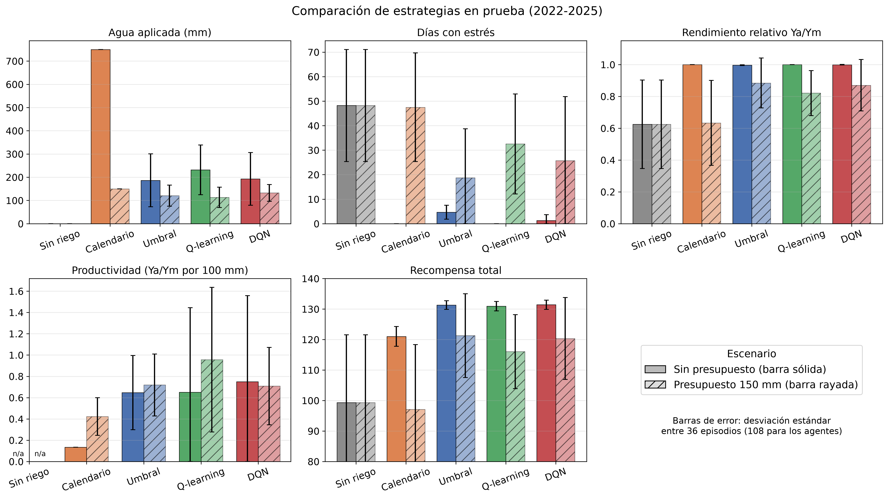
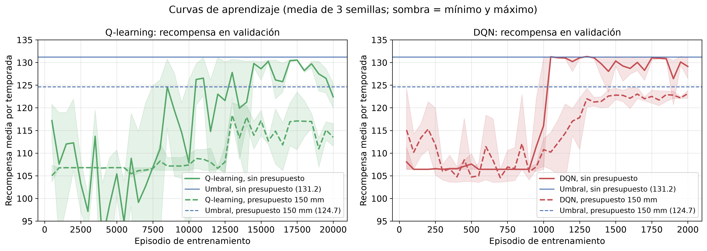
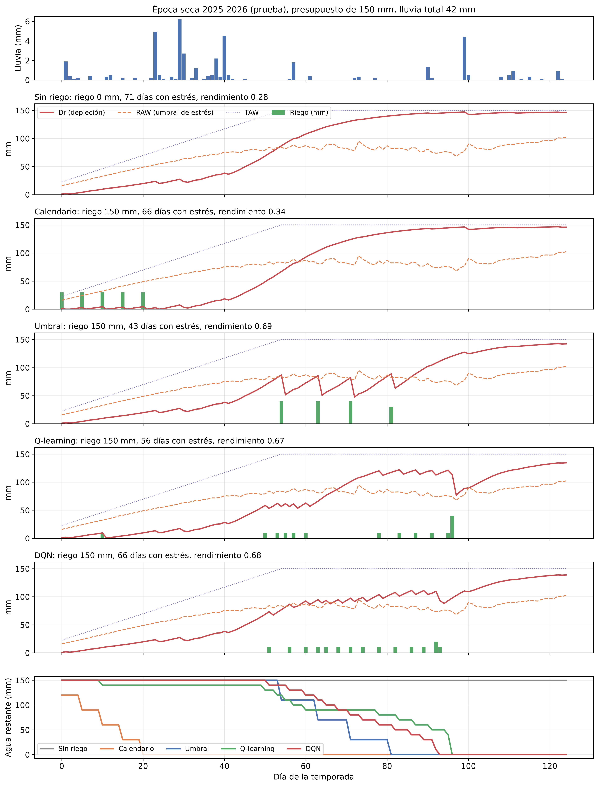

# RiegoRL

Proyecto final del curso CC3104 Aprendizaje por Refuerzo (Universidad del Valle de Guatemala).

**RiegoRL** es un agente de aprendizaje por refuerzo que decide cada día cuánta agua aplicar a una parcela de maíz. Busca maximizar el rendimiento relativo y minimizar el agua aplicada y el estrés hídrico. El entorno simula el balance hídrico del suelo con FAO-56 usando datos climáticos reales de Chiquimula, en el Corredor Seco de Guatemala.

## Video de presentación

Presentación del proyecto y ejecución del programa: [https://youtu.be/rxHjj0YbTBg](https://youtu.be/rxHjj0YbTBg)

## El problema

- **Cultivo:** maíz de grano, temporada de 125 días (etapas de 20, 35, 40 y 30 días).
- **Decisión diaria:** aplicar 0, 10, 20, 30 o 40 mm de riego.
- **Clima:** lluvia y evapotranspiración de referencia (ET₀) reales de Open-Meteo, 2000 a junio de 2026.
- **Épocas de siembra:** 15 de mayo (primera), 1 de septiembre (postrera) y 15 de noviembre (época seca).
- **Información del agente:** depleción relativa del suelo, avance de la temporada, etapa, un pronóstico ruidoso de lluvia a 3 días, la ET₀ del día y la fracción de agua restante del presupuesto (1.0 si no hay presupuesto).
- **Splits por año de siembra:** `train` 2000-2019, `val` 2020-2021, `test` 2022 en adelante (solo temporadas completas).

## Instalación

Requiere Python 3.10 o superior (solo CPU).

```bash
python -m venv .venv
.venv\Scripts\activate        # en Linux/Mac: source .venv/bin/activate
pip install -r requirements.txt
```

## Uso

El CSV climático ya está en el repositorio, así que todo corre sin internet.

```bash
# (Opcional) volver a descargar el clima real
python data/descargar_clima.py
# (Respaldo sin internet) clima SINTÉTICO, no real
python data/descargar_clima.py --sintetico

# Pruebas
python -m pytest tests

# Evaluar las estrategias de referencia en validación
python scripts/evaluar_baselines.py

# Figura de una temporada con las tres estrategias
python scripts/graficar_trayectoria.py
```

Salidas:

- `results/figures/clima_mensual.png`: lluvia y ET₀ promedio por mes.
- `results/figures/trayectoria_baselines.png`: una temporada con Dr, RAW, lluvia y riegos.
- `results/tablas/baselines_val.csv`: resumen (media y desviación estándar) por estrategia, sin presupuesto de agua.
- `results/tablas/baselines_val_presupuesto150.csv`: lo mismo con un presupuesto de 150 mm por temporada.
- `results/tablas/*_episodios.csv`: una fila por episodio de cada evaluación.

Uso mínimo del entorno:

```python
from riego_rl.entorno import RiegoEnv

env = RiegoEnv(split="train", semilla=0)
obs, info = env.reset()
obs, recompensa, terminated, truncated, info = env.step(env.action_space.sample())
```

En `val` y `test`, `env.reset(options={"indice": k})` recorre las temporadas en orden (`env.n_temporadas`).

Presupuesto de agua opcional (mm por temporada; por defecto sin límite):

```python
env = RiegoEnv(split="val", config={"PRESUPUESTO_AGUA_MM": 150})
```

## Estructura

```
├── config.py                 parámetros del simulador, entorno y recompensa
├── data/                     descarga y CSV del clima de Chiquimula
├── riego_rl/
│   ├── suelo.py              balance hídrico FAO-56 (una capa)
│   ├── entorno.py            RiegoEnv (Gymnasium)
│   ├── baselines.py          sin riego, calendario y umbral
│   ├── evaluacion.py         evaluar_politica() y resumen()
│   ├── qlearning.py          Q-learning tabular (numpy)
│   ├── dqn.py                DQN (PyTorch)
│   └── utilidades.py         escenarios, carga de modelos y trayectorias
├── scripts/                  entrenamiento, evaluación, figuras, demo y pipeline
├── tests/                    pruebas con pytest
├── results/                  figuras, tablas y modelos
└── docs/                     ITERACIONES, EXPLICACION_CODIGO, REGISTRO_IA
```

La explicación detallada del código y del MDP está en [`docs/EXPLICACION_CODIGO.md`](docs/EXPLICACION_CODIGO.md).

## Limitaciones del simulador

- **Una sola capa de suelo** con parámetros fijos (franco, θ_FC = 0.30 y θ_WP = 0.15). No hay variación espacial ni textura distinta.
- **Una sola localidad**: el clima viene de la reanálisis de Open-Meteo para un punto (14.80, -89.54), no de una estación en campo.
- **Sin evaporación del suelo separada**: se usa Kc único (ETc = Kc · ET₀), sin Kcb + Ke.
- **Escorrentía simple**: pérdida lineal sobre un umbral de 20 mm/día, sin considerar pendiente ni humedad previa.
- **Rendimiento con un Ky único** para toda la temporada (1.25); FAO-33 usa un Ky distinto por etapa. No modela plagas, fertilidad ni temperatura.
- **El riego se aplica y se infiltra el mismo día**, con eficiencia 100 %. No hay costo de bombeo; el límite de agua por temporada es opcional (`PRESUPUESTO_AGUA_MM`).
- **El pronóstico es sintético**: lluvia real con ruido lognormal y falsos secos, no un pronóstico meteorológico real.
- Las temporadas de siembra son 3 fechas fijas por año; los splits tienen pocas temporadas (60 en entrenamiento, 6 en validación, 12 en prueba).

## Agentes de RL

Los dos agentes están implementados a mano: Q-learning tabular con numpy y DQN con PyTorch, solo CPU. La explicación del código, la relación con la ecuación de Bellman y las preguntas probables están en [`docs/EXPLICACION_CODIGO.md`](docs/EXPLICACION_CODIGO.md). Las iteraciones de diseño, con hipótesis y resultados en validación, están en [`docs/ITERACIONES.md`](docs/ITERACIONES.md).

| | Q-learning (`riego_rl/qlearning.py`) | DQN (`riego_rl/dqn.py`) |
|---|---|---|
| Estado | Dr/TAW en 10 intervalos × etapa (4); con presupuesto, × agua restante (3). Sin pronóstico (iteración 3) | Observación continua de 6 valores |
| Aprendizaje | α de 0.1 a 0.01, γ = 0.99, Q inicial optimista de 80 (iteración 1) | MLP 64-64, replay de 50 000, lote de 64, red objetivo cada 1 000 pasos, Huber, Adam 1e-3, γ = 0.99 |
| Exploración | ε de 1.0 a 0.05 durante el 70 % de 20 000 episodios | ε de 1.0 a 0.05 durante la mitad de 2 000 episodios |
| Tiempo de entrenamiento (3 semillas en paralelo) | unos 90 s | de 2.5 a 3.5 min |

Se entrenan con las semillas 0, 1 y 2 en las 60 temporadas de `train`. Se guarda el modelo con mayor recompensa en `val`. Los hiperparámetros finales están marcados en `config.py`.

```bash
# Pipeline completo desde cero (pruebas, entrenamiento, evaluación, figuras y demo), unos 10 min
python scripts/correr_pipeline.py

# O paso a paso
python scripts/entrenar_qlearning.py                    # sin presupuesto
python scripts/entrenar_qlearning.py --presupuesto 150
python scripts/entrenar_dqn.py
python scripts/entrenar_dqn.py --presupuesto 150
python scripts/evaluar_todo.py                          # evaluación final en test, no entrena
python scripts/generar_figuras.py
python scripts/demo_temporada.py --anio 2023 --temporada primera --agente dqn
```

Tiempos medidos en `results/tablas/tiempos_pipeline.csv` (Mac con 10 núcleos, CPU). El pipeline reproduce exactamente la tabla de resultados.

Las iteraciones se reproducen con banderas de los mismos scripts, por ejemplo `entrenar_qlearning.py --q-inicial 0 --alpha-fin 0.1 --con-pronostico --sufijo v1` (Q-learning v1), `--sin-pronostico` o `--lambda-agua 0.6`. Ver `--help`.

Salidas:

- `results/modelos/`: modelos finales `{qlearning,dqn}_{sinpres,pres150}_s{0,1,2}` y los de cada iteración (con sufijo).
- `results/tablas/resultados_prueba.{csv,md}` y `resultados_por_temporada.csv`: evaluación final en test.
- `results/tablas/val/` y `results/tablas/curvas/`: evaluación en val y curvas de cada experimento.
- `results/figures/`: curvas, comparación, trayectoria, dispersión, mapa de la política y `demo.gif`.

## Resultados

Evaluación final en `test` (12 temporadas, 2022-2025), semillas 0, 1 y 2. Media ± desviación estándar entre episodios (36 por estrategia de referencia y 108 por agente: 3 modelos × 36).

| Escenario | Estrategia | Agua (mm) | Días con estrés | Rend. relativo | Recompensa |
|---|---|---|---|---|---|
| Sin presupuesto | Sin riego | 0 | 48.2 ± 22.9 | 0.625 ± 0.278 | 99.3 ± 22.3 |
| Sin presupuesto | Calendario | 750 | 0.0 | 1.000 | 121.0 ± 3.2 |
| Sin presupuesto | Umbral | 187 ± 114 | 4.7 ± 2.8 | 0.997 ± 0.003 | 131.3 ± 1.4 |
| Sin presupuesto | Q-learning | 232 ± 107 | 0.0 | 1.000 | 130.9 ± 1.5 |
| Sin presupuesto | **DQN** | 193 ± 113 | 1.3 ± 2.4 | 0.999 ± 0.002 | **131.4 ± 1.5** |
| 150 mm | Sin riego | 0 | 48.2 ± 22.9 | 0.625 ± 0.278 | 99.3 ± 22.3 |
| 150 mm | Calendario | 150 | 47.5 ± 22.2 | 0.634 ± 0.267 | 97.1 ± 21.3 |
| 150 mm | **Umbral** | 121 ± 45 | 18.7 ± 20.0 | 0.884 ± 0.157 | **121.3 ± 13.7** |
| 150 mm | Q-learning | 114 ± 44 | 32.5 ± 20.4 | 0.821 ± 0.141 | 116.0 ± 12.1 |
| 150 mm | DQN | 132 ± 36 | 25.7 ± 26.1 | 0.870 ± 0.162 | 120.3 ± 13.4 |

La tabla con productividad del agua está en `results/tablas/resultados_prueba.md`.







### Conclusiones

- **Sin presupuesto, DQN iguala a la regla por umbral** (131.4 contra 131.3 de recompensa), con 3.4 días de estrés menos por temporada y casi la misma agua. La diferencia de recompensa es menor que la variación entre semillas: es un empate, no una victoria.
- **Q-learning llega al mismo nivel solo después de dos iteraciones.** La versión inicial regaba 399 mm en val porque nunca exploró el suelo seco (exploración uniforme e inicialización pesimista). Con Q optimista, α decreciente y sin el pronóstico en el estado llega a 130.9, aunque gasta 45 mm más que el umbral.
- **Con presupuesto de 150 mm el RL no supera al umbral**, al contrario de nuestra hipótesis inicial. En la época seca todas las estrategias gastan los 150 mm y terminan igual. Fuera de ella, los agentes ahorran de más. La causa está en el simulador: el rendimiento usa un Ky único para toda la temporada, así que el agua vale lo mismo en cualquier etapa y reservarla para la floración no da ventaja.
- **El pronóstico de lluvia no aporta** en este simulador: quitarlo mejora a Q-learning (menos estados) y no cambia a DQN.
- La regla por umbral es un rival muy fuerte porque ya está diseñada con el mismo modelo FAO-56 que usa el simulador. El valor del RL sería mayor en un simulador con Ky por etapa, pronósticos más largos o costos de agua variables.
